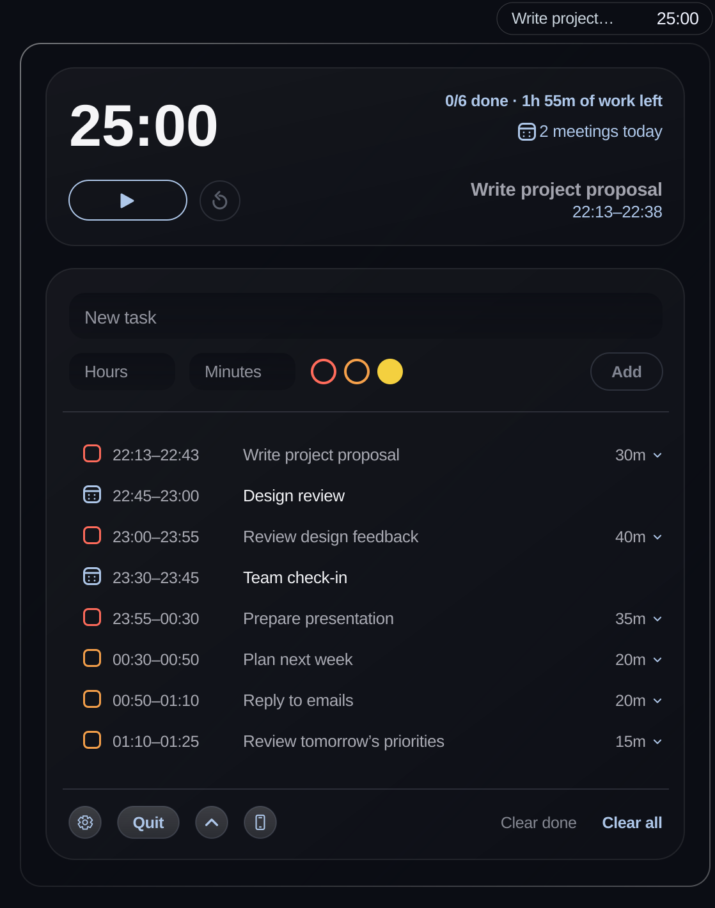

# Pomodoro

A pomodoro timer for your Mac menu bar.

Pomodoro lives in your Mac's menu bar and turns your to-do list into focus
blocks and breaks, fitted around your meetings.



## How it works

- **Add all your tasks for the day.** Add each task and how long you think it
  will take.
- **Add a priority to each task with one click.** Choose red, orange or yellow
  to mark how urgent each task is, then click Add. Pomodoro puts the most urgent
  tasks first.
- **We work out the intervals.** Pomodoro splits your tasks into focus blocks,
  with short breaks between them and a longer one after every fourth. Click a
  task to see its individual blocks.
- **We fit our timings around your schedule.** You connect your calendar and we
  work out the rest using your Mac calendar (iCloud, Google, Outlook, Exchange
  and more).
- **Keep your timer close.** Fold away the task list to keep just the timer and
  controls open. Your current task and time remaining stay in the menu bar.

## Features

- Tick tasks off like a to-do list. Finish early and the next task moves
  straight into your time.
- The time left on your current block is right there in the menu bar, with a
  heads-up when a meeting is about to start.
- Start, pause or reset in one click, or jump straight to any block.
- Set your own block and break lengths and when your day starts.
- Built for macOS, in Light and Dark mode.

## Privacy

No account, no analytics, no advertising and no tracking. Your tasks and
settings stay on your Mac. Calendar access is optional, and your events are read
on your Mac and never sent anywhere. See the
[privacy policy](docs/privacy-policy.md).

## Download

Get the signed, notarized app from
[quietpomodoro.com/mac](https://quietpomodoro.com/mac/). It needs macOS 14 or
later, on Apple silicon or Intel.

## Build from source

You need Xcode 26 or later.

```sh
swift package resolve
./build.sh
open Pomodoro.app
```

Before you run a local build:

- It uses the same bundle ID as the official app, so the two share settings and
  tasks.
- `./build.sh` quits any running copy of Pomodoro, then reopens it.
- Without a Developer ID, macOS asks for calendar access again after every
  rebuild. Copy `signing.example.sh` to `.signing.local.sh` to set an identity.
- It doesn't check for updates. Set `APPCAST_URL` to point a build at a feed.

## Test

```sh
swift test --disable-sandbox
python3 -m unittest discover -s Tests -p 'test_*.py'
```

## Contributing

Issues and pull requests are welcome. For a larger change, open an issue first.

If you change text the user sees, run `Tools/sync-localizations.sh` and translate
the new strings. The [release guide](docs/website-release.md#translations) has
the details.

By submitting a contribution, you agree that CODE MOORE LTD can use it under any
license, including in the official app.

Report security problems privately, as described in [SECURITY.md](SECURITY.md).

## Sharing a fork

You can share your changed version for free, but you can't sell it. Before you
do:

1. Replace `com.codemoore.pomodoro.menubar` and `quietpomodoro.com` everywhere
   they appear, including the update feed, website links, translations and
   tests.
2. Delete `sparkle_public_key.txt` and run `./setup-sparkle-key.sh` to create
   your own update signing key.
3. Replace the app icon and the Quiet Pomodoro name.
4. Update the repositories and signing identity in
   `.github/workflows/release.yml` and `Tools/ci-publish.sh`.
5. Keep the `LICENSE` file, including its `Required Notice` line.

The rest of the release process is in the
[release guide](docs/website-release.md).

## License

The source code is available under the
[PolyForm Noncommercial License 1.0.0](LICENSE). You can use and change it for
personal and other noncommercial purposes, but you can't sell it or use it
commercially. This makes Pomodoro source-available, not open source.

The license covers the code in this repository. The official app from
quietpomodoro.com is free to download and use, including at work.

The license doesn't cover the Quiet Pomodoro name, the quietpomodoro.com domain
or the app icon in `Resources/AppIcon.icon`. All rights to those are reserved,
so forks need their own name and icon.

The direct-download app includes [Sparkle](https://sparkle-project.org), which
has its own [license](https://github.com/sparkle-project/Sparkle/blob/2.x/LICENSE).
